# Christopia — Diagrams
See [OUTLINE.md](OUTLINE.md) and [REDESIGN_PLAN.md](REDESIGN_PLAN.md)

## Plan
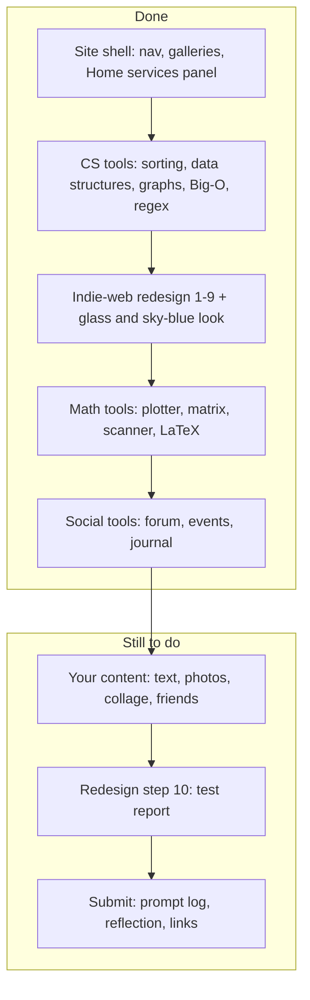
Where the project stands. Each box is one or more commits; `OUTLINE.md` has the details.

## Sitemap
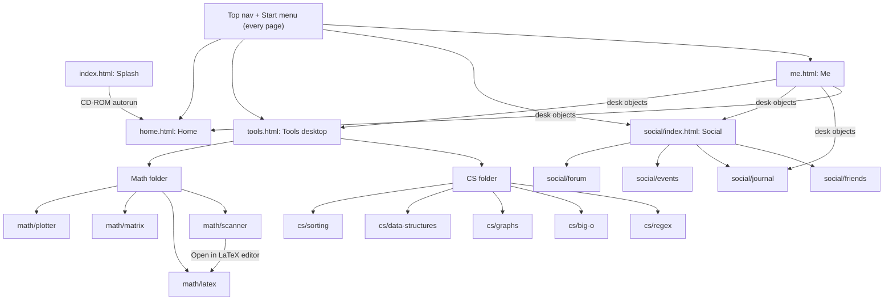
Eighteen pages. The splash leads to Home; the nav and the Start menu reach every page. Tools is a desktop of folders; tool pages link back through their address bar (Math, CS) or sub-nav (Social).

## Splash and Home wireframes
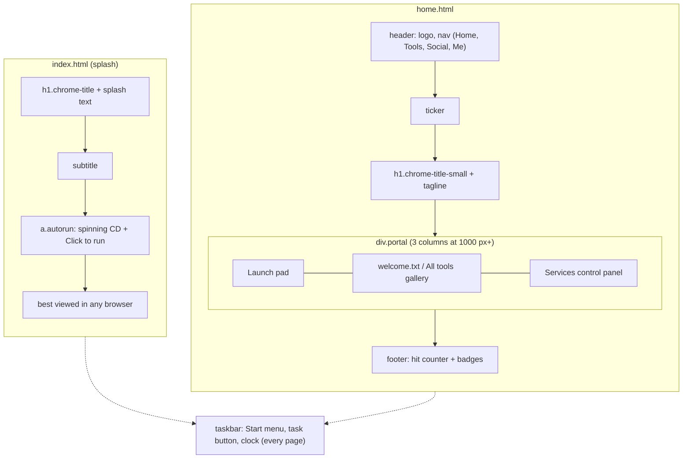
The splash is just the title and a CD-ROM button; Home is the three-column portal.

## Tool page layout
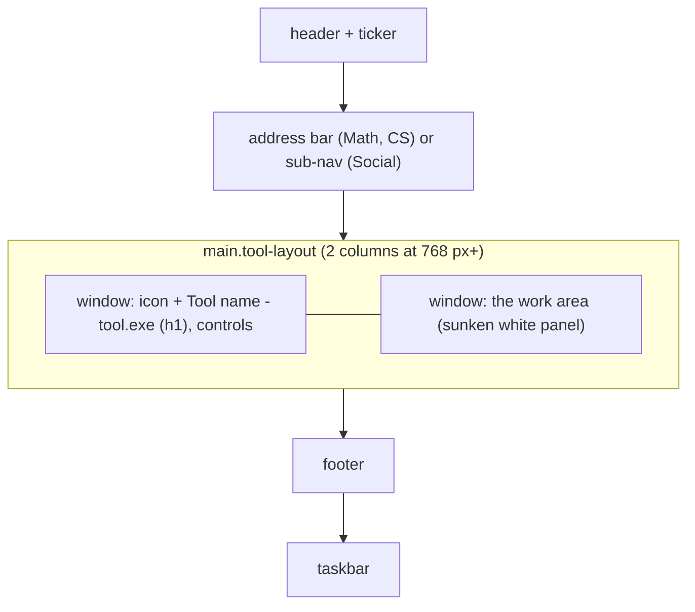
Every tool page: two 98 windows, controls on the left and the stage on the right (stacked on phones).

## Sticker layers
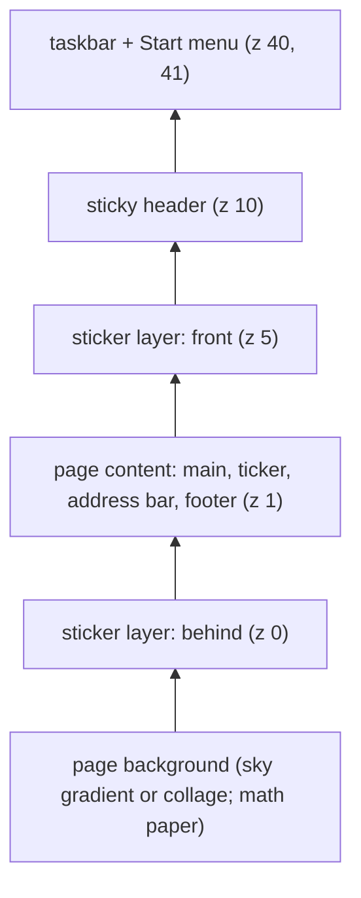
Bottom to top: what paints over what. Both sticker layers cover the whole page, scroll with it, and let clicks through except on link stickers.

## Code structure
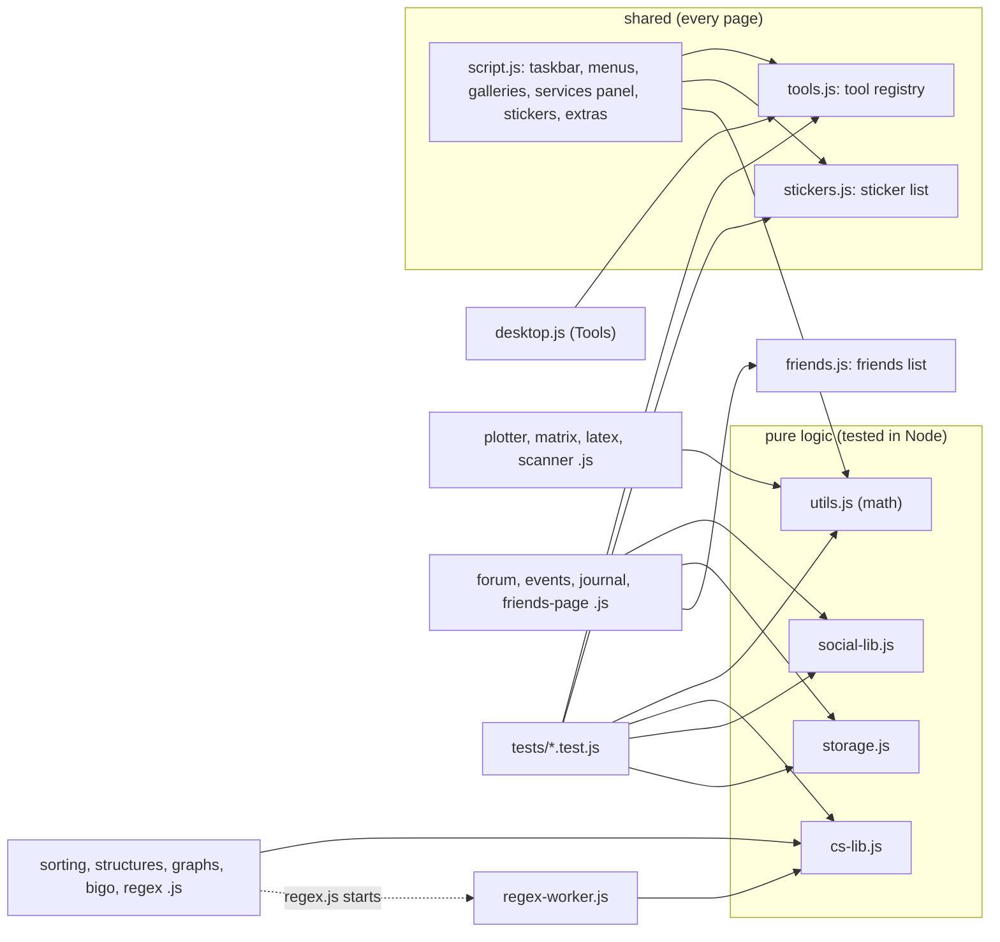
Page scripts import the pure library for their section; the data files (`tools.js`, `stickers.js`, `friends.js`) are the places you edit to add things.

## Visualizer pattern (Sorting, Graphs, Data Structures)
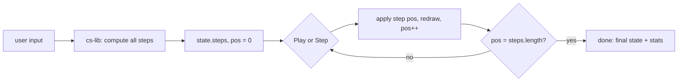
Compute first, animate after: the library is tested in Node, the page only replays.

## Regex matching with a time limit
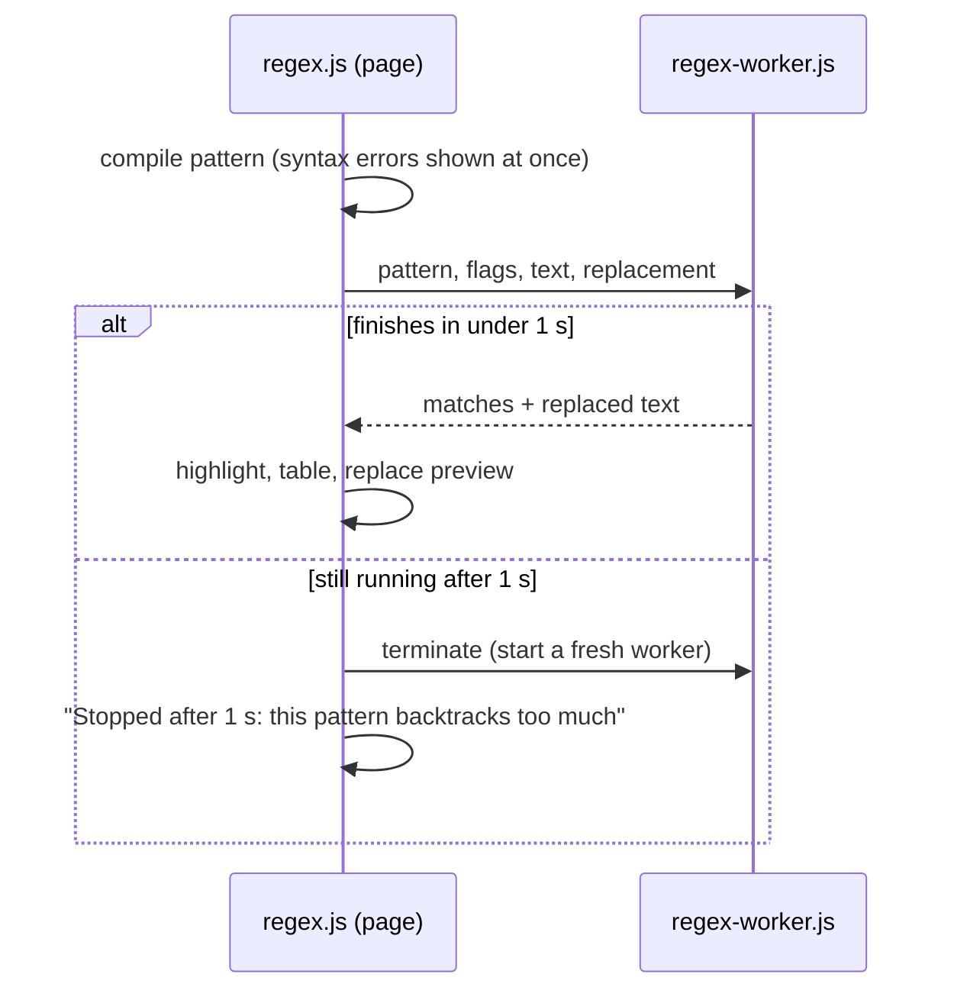
A runaway pattern can only be stopped by killing the thread it runs on, so matching lives in a worker.

## Plotter flow
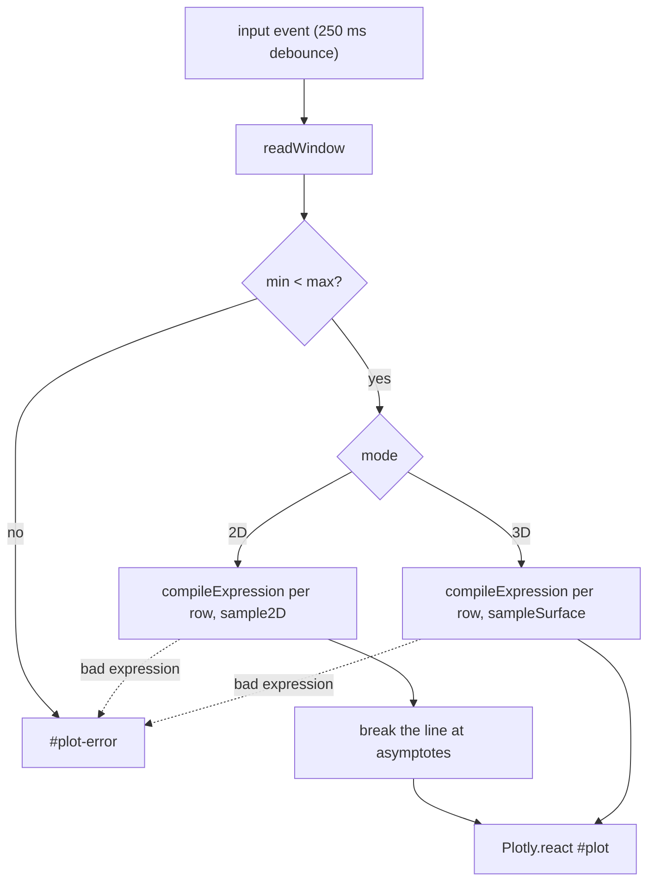
How an edit becomes a redrawn graph. A row with a typo is skipped and named in the error line; the others still draw.

## Scanner to LaTeX
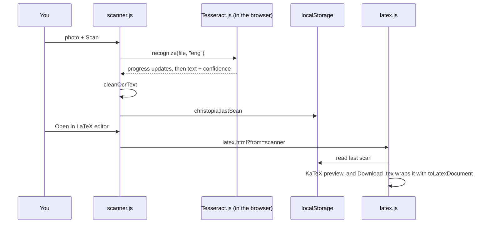
The photo never leaves the browser; the two pages share the text through localStorage.

## Journal
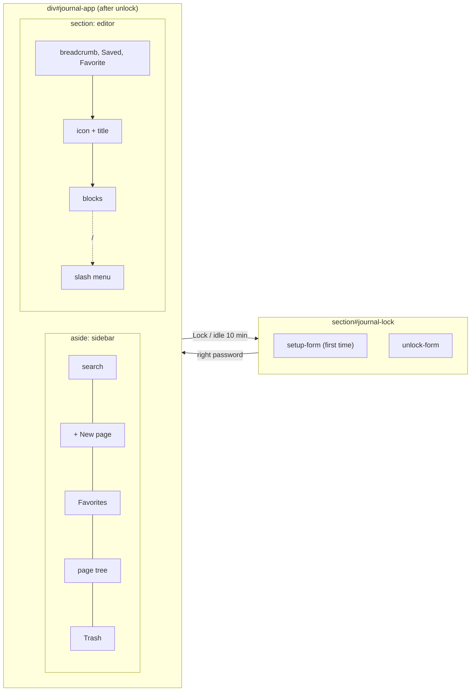
The lock screen and the two-pane Notion-style app it opens.

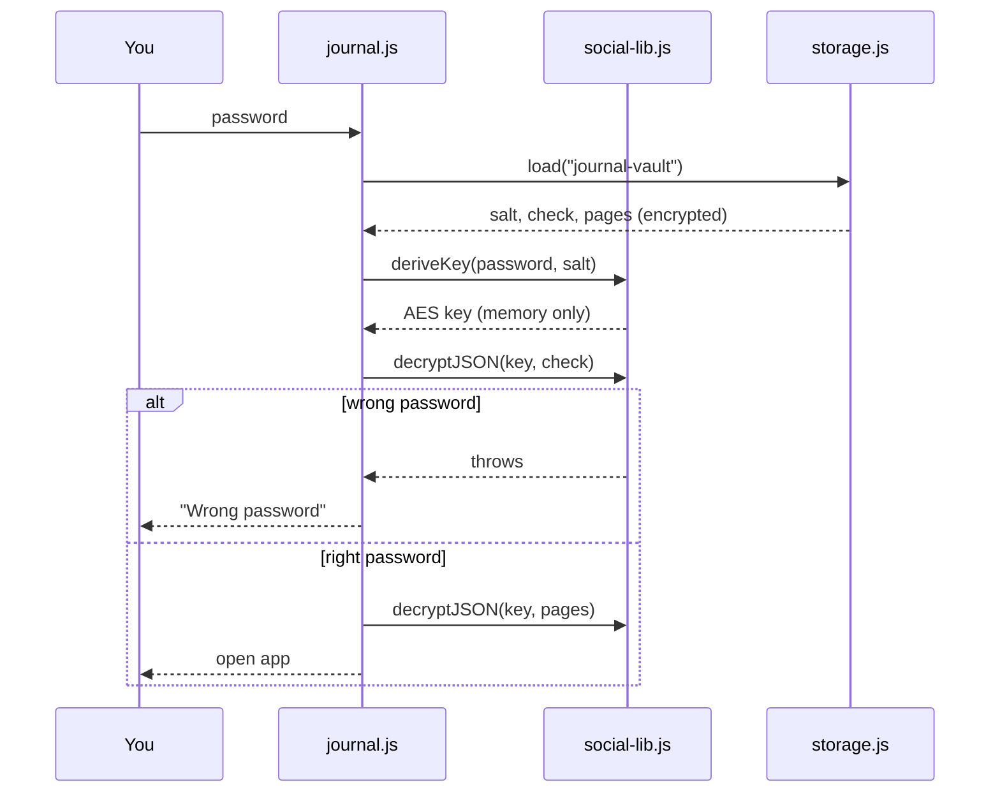
The password never leaves memory and is never saved; a wrong key makes AES-GCM fail.

## Requirements → code
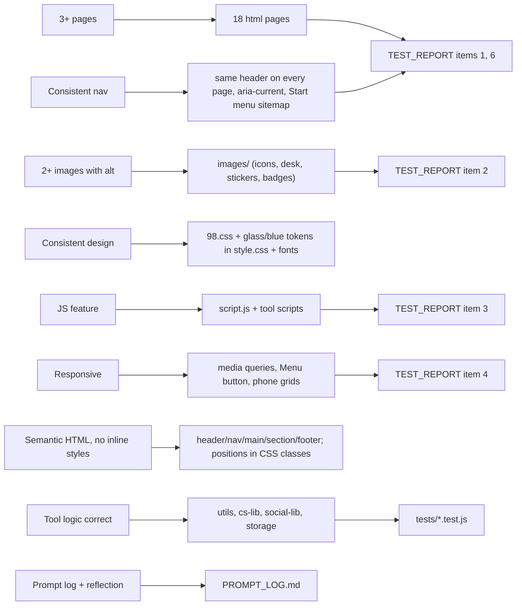
Each spec requirement, the code that satisfies it, and the test or report item that checks it.
