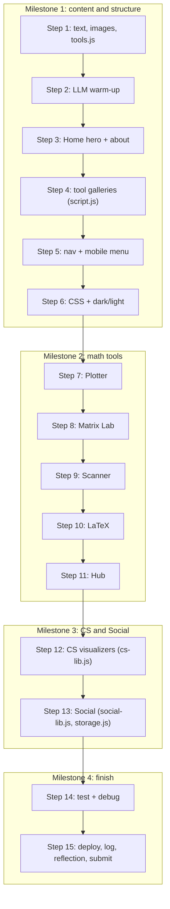
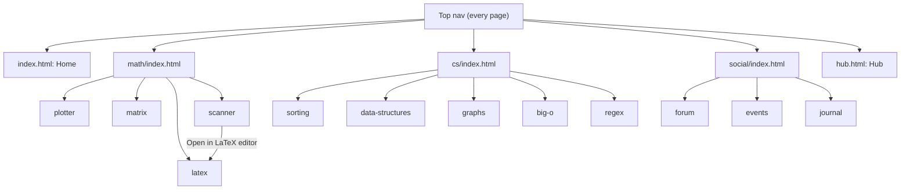
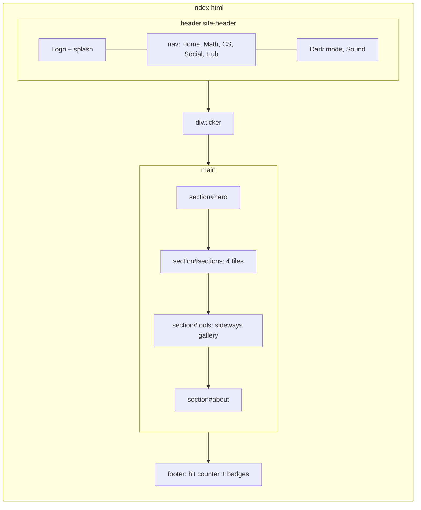
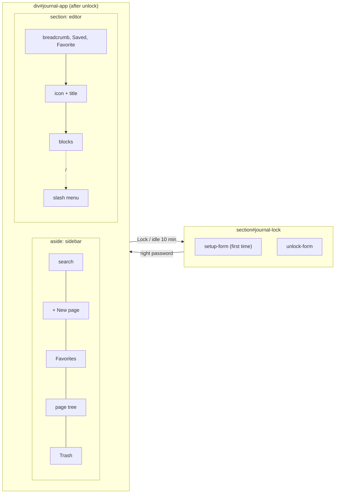
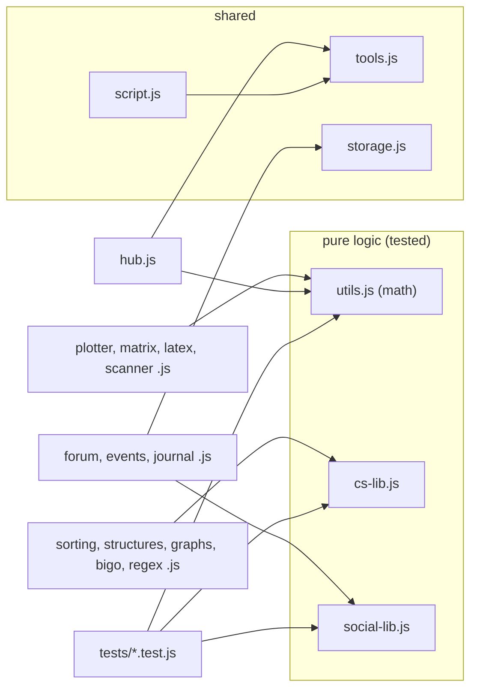
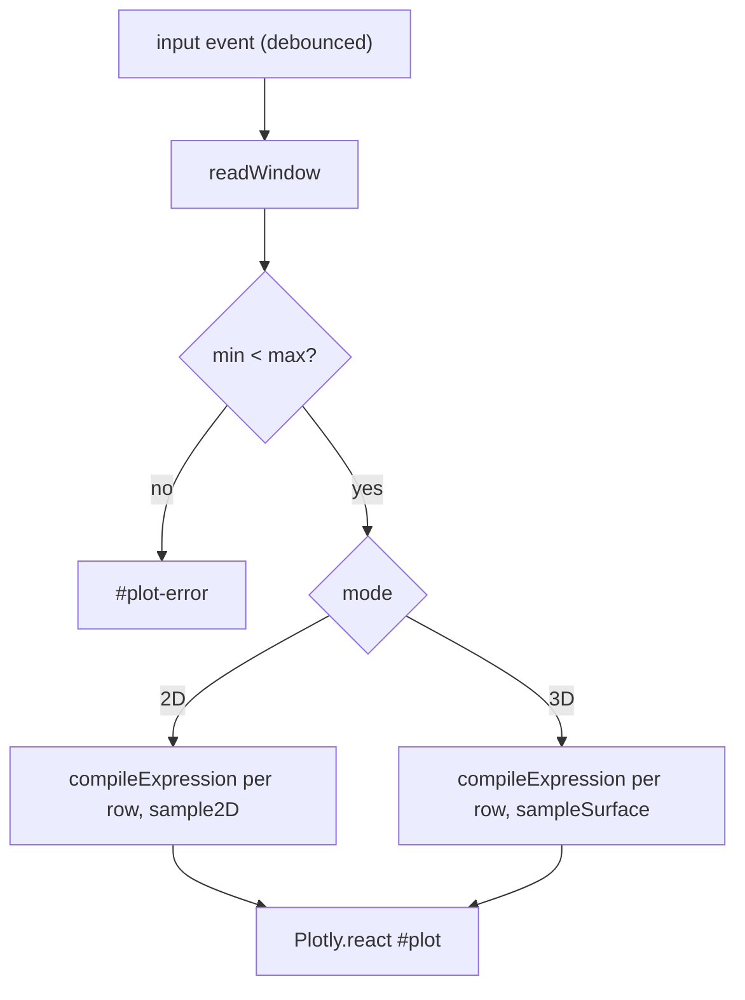
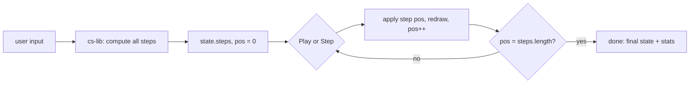
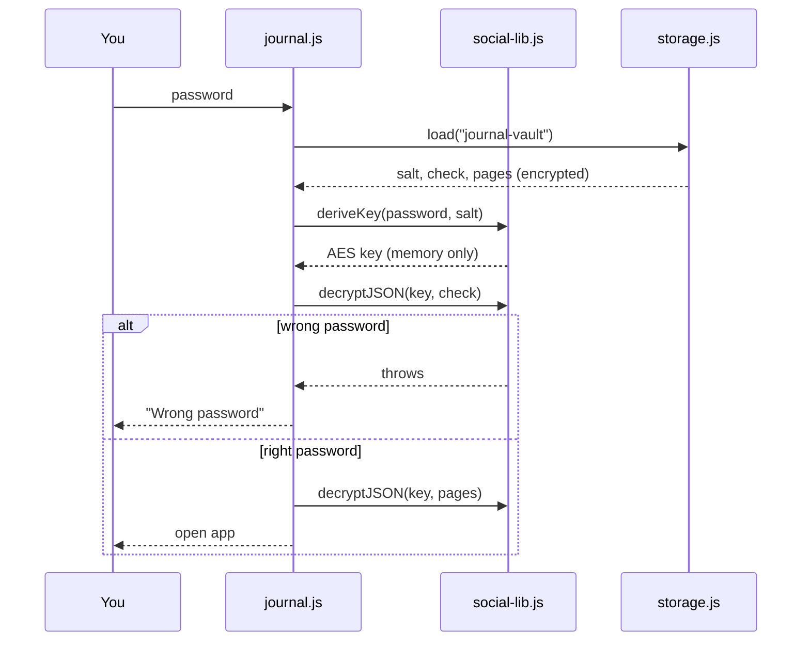
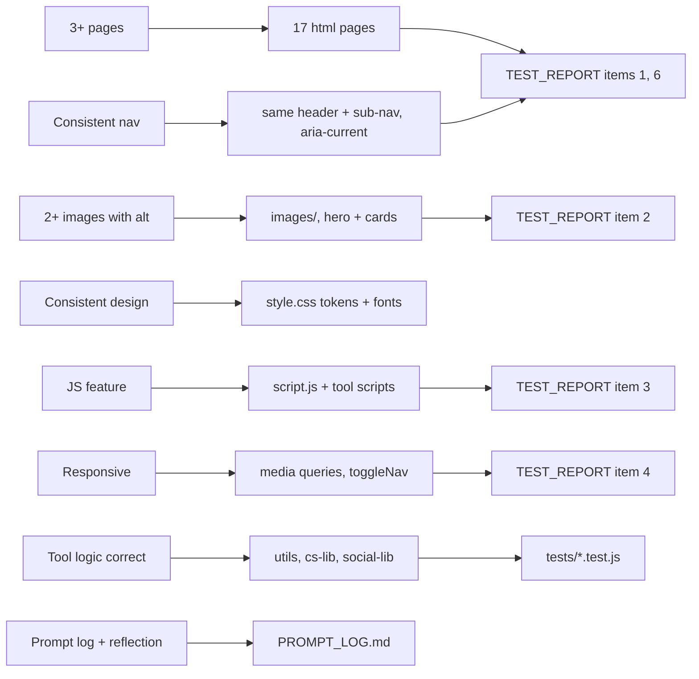

# Christopia — Diagrams
See [OUTLINE.md](OUTLINE.md)

## Plan

The plan steps in order, grouped into four milestones; commit after each step.

## Sitemap

Five top-level destinations; each section's overview and sub-nav link its tool pages. The Scanner hands text to the LaTeX page.

## Home page wireframe

Home page from top to bottom. Section pages add a `nav.sub-nav` bar under the ticker.

## Journal layout

The lock screen and the two-pane Notion-style app it opens.

## Code structure

Page scripts import the pure library for their section; Social pages also go through `storage.js`.

## Plotter flow

How an edit becomes a redrawn graph.

## Visualizer pattern (Sorting, Graphs, Data Structures)

Compute first, animate after: the library is tested in Node, the page only replays.

## Journal unlock

The password never leaves memory and is never saved; a wrong key makes AES-GCM fail.

## Requirements → code

Each spec requirement, the code that satisfies it, and the test or report item that checks it.
