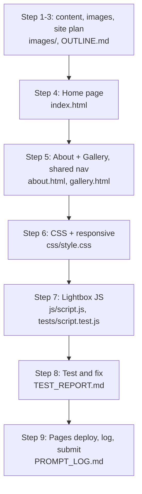
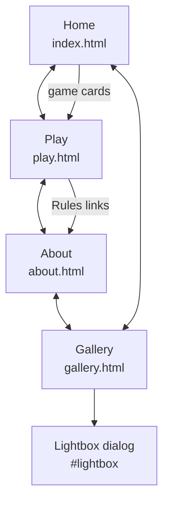
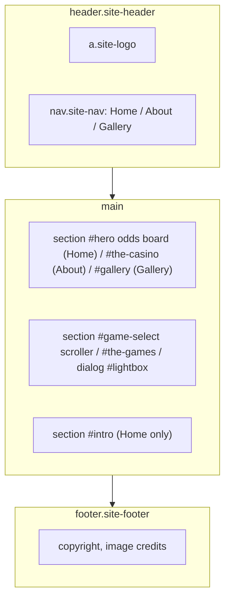
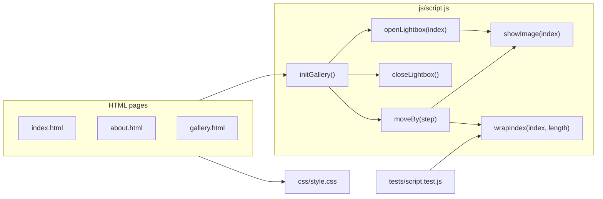
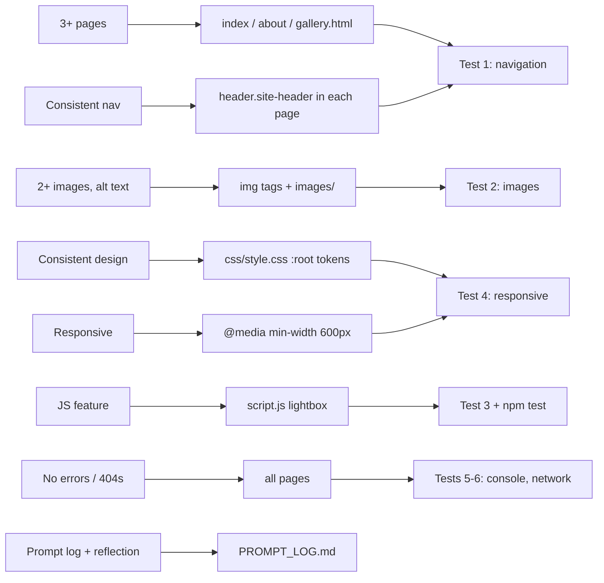

# Longshot Website — Diagrams
See [OUTLINE.md](OUTLINE.md)

## Plan

Each step ends with a commit, as the spec requires.

## Sitemap

All four pages share the same nav, so each links to the others. Home game cards open the Play page; each game links to its rules on About.

## Page wireframe (every page)

Same header and footer on every page; the main sections change per page.

## Code structure

All pages load the same stylesheet and script; `initGallery` returns early on pages with no `#lightbox`.

## Requirements → code

Each requirement, the file that meets it, and the test report item that checks it.
