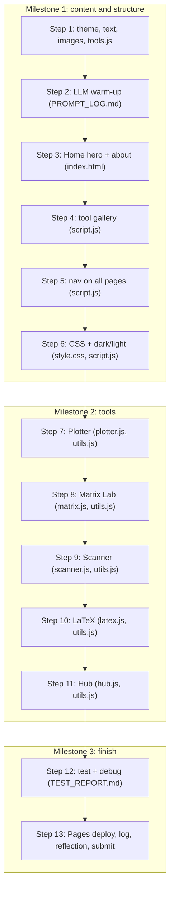
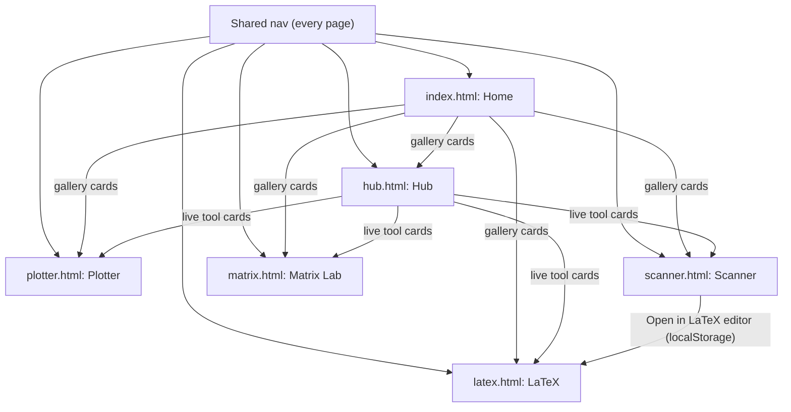
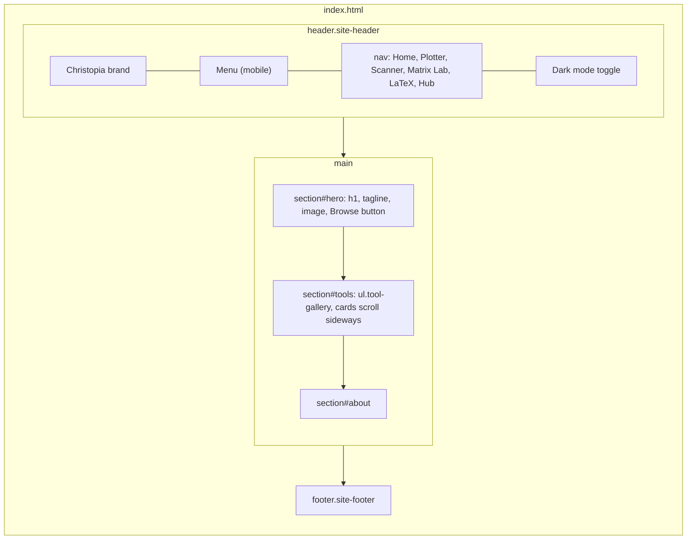
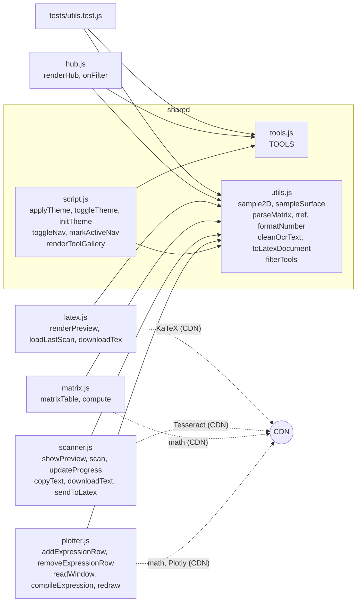
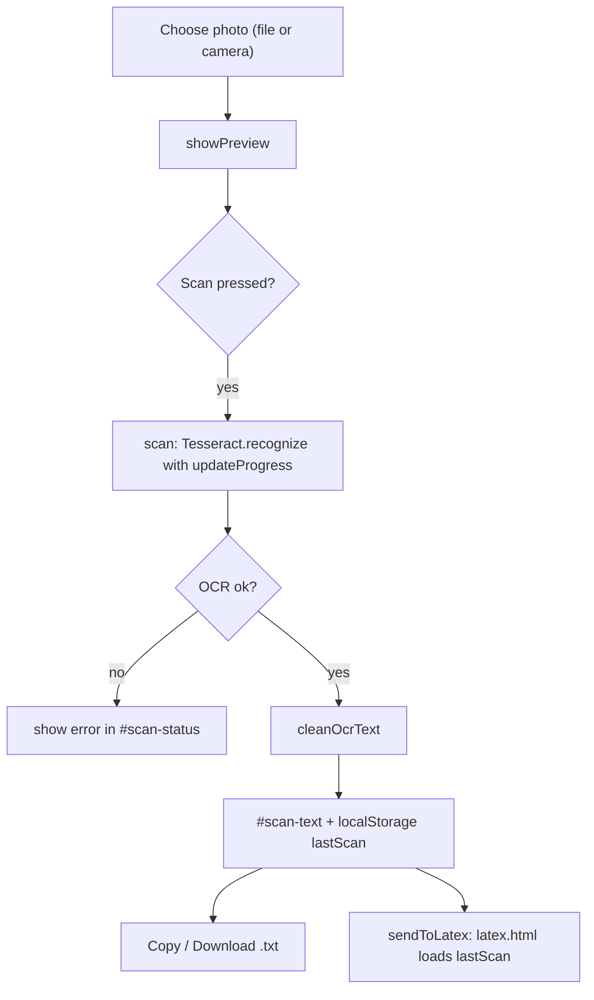
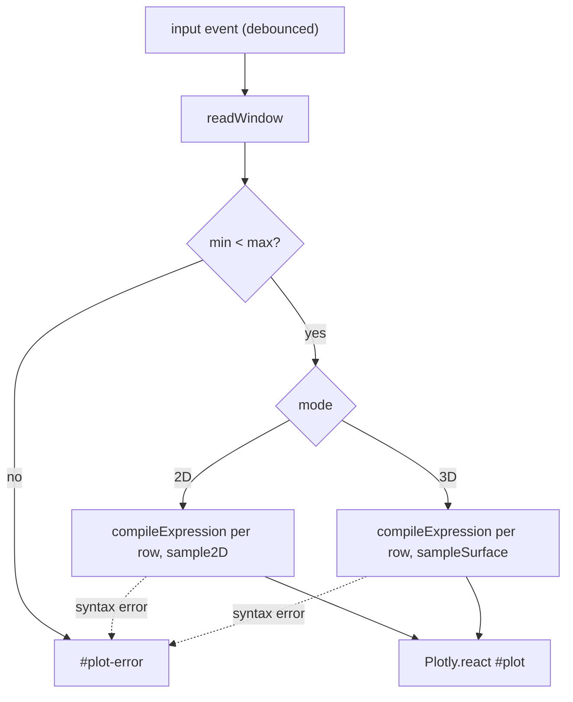
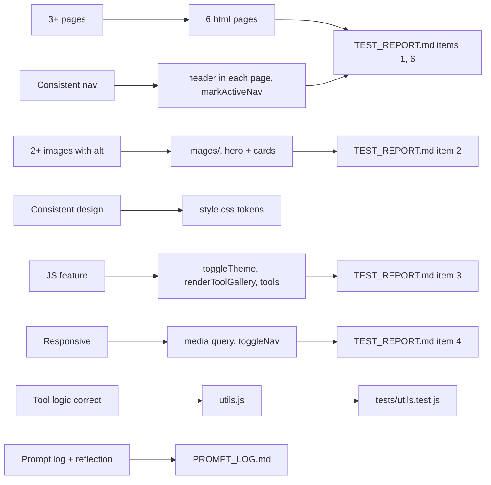

# Christopia — Diagrams
See [OUTLINE.md](OUTLINE.md)

## Plan

The plan steps in order, grouped into three milestones; commit after each step.

## Sitemap

Every page links to every other through the nav; the gallery and Hub also link to tools, and the Scanner hands text to the LaTeX page.

## Home page wireframe

Layout of the home page from top to bottom; the tool gallery scrolls horizontally with scroll-snap.

## Code structure

Files and their functions; arrows are imports, dotted arrows are globals from pinned CDN scripts.

## Scanner flow

What happens from choosing a photo to typed text and the handoff to the LaTeX page.

## Plotter flow

How an edit becomes a redrawn graph.

## Requirements → code

Each spec requirement, the code that satisfies it, and the test or report item that checks it.
