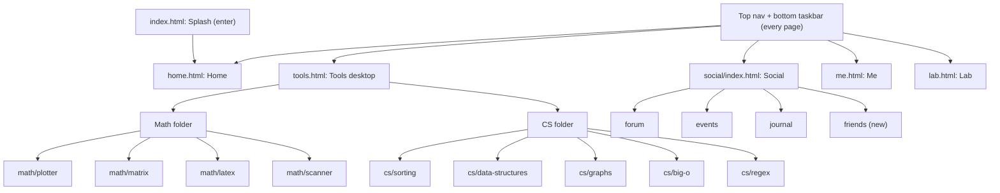

# Christopia redesign plan: indie web + 98.css

Goal: turn Christopia from a glossy console-menu site into an **indie-web / Neocities-style** personal site, a "union" for people who find it online and for friends in real life. Keep the maximalist energy (collage, stickers, gifs, buttons), but put the actual content in plain, simple **98.css windows**: *simpler is better*.

Nothing here is built yet. Your decisions (section 7) are already applied throughout this plan.

---

## 1. What the reference sites do

| Site | Idea worth taking | How it shows up in Christopia |
|---|---|---|
| [mental-labour](https://mental-labour.neocities.org/) | **Splash page**: one big pixel-art image is the "door" into the site; title is an image in a blackletter font; tiled grid background. | Optional entrance page: big title + one clickable picture. |
| [knoxstation](https://knoxstation.neocities.org) | **Portal layout**: banner header, dropdown top nav, a scrolling marquee, 3 columns (left nav, center welcome, right "updates / image of the now / status" widgets), mascots and gifs absolutely positioned over the edges (183 gifs on the home page), "add my button" 88×31, guestbook, shrines, little iframe widgets. | Home page layout; sticker layer; buttons wall; "now" widgets; updates log. |
| [simone.computer](https://simone.computer/#/webdesktops) | **Web desktop**: fake boot screen, a desktop of icons, draggable OS windows, a CRT/LCD toggle, "0 of 338 visited" counter. | Tools page as a desktop of icons in a window; bottom taskbar with a Start menu. |
| [caramelfevers](https://caramelfevers.neocities.org) | **Scene navigation**: the home page is a drawing of a table; each real object on it (cut-out photos of food, a gumball machine, doors) is a link to a section. Plus "today's quest", an updates log, a webring, a guestbook. | "Me" page as a scene made from photos of your stuff; doors as links. |

Common threads: hand-made images over text, one personality per page, updates log, guestbook, webring, 88×31 buttons, and content in small boxes rather than full-width layouts.

---

## 2. New structure

Visitors land on a splash page, then the top nav has five places: Home, Tools, Social, Me, Lab. Math and CS merge into **Tools**.

| Now | After |
|---|---|
| Home (`index.html`) | **Splash** (`index.html`): big CSS chrome title + one big "enter" door.<br>**Home** moves to `home.html`: welcome window, updates, now box, buttons wall |
| Math (`math/index.html`) + CS (`cs/index.html`) | **Tools** (`tools.html`): one desktop window with a *Math* folder and a *CS* folder. Delete both section index pages. |
| Tool pages in `math/` and `cs/` | Unchanged URLs, so links people saved keep working; only their look changes. |
| Social (`social/`) | **Social**: forum, events, journal, plus a new **Friends** page (friends' 88×31 buttons, links, guestbook). |
| (none) | **Me** (`me.html`): about you, as a scene of your things plus a short text window. |
| Hub (`hub.html`) | **Lab** (`lab.html`): planned tools and experiments, under-construction GIFs. |


Proposed sitemap; this replaces the Sitemap diagram in `DIAGRAM.md`.

---

## 3. Look: 98.css as the frame, maximalism around it

- **Add 98.css** (pinned): `<link rel="stylesheet" href="https://unpkg.com/98.css@0.1.21/dist/98.css">` before `css/style.css`. It gives `.window`, `.title-bar`, `.window-body`, `.status-bar`, beveled buttons, fieldsets, tabs, tree views and progress bars, using plain HTML.
- **Every content section becomes a window**:
  ```html
  <section class="window" aria-labelledby="w-plot">
    <div class="title-bar"><h2 class="title-bar-text" id="w-plot">plotter.exe</h2></div>
    <div class="window-body">…</div>
  </section>
  ```
- **Delete** (simpler is better): frosted glass, the gloss gradients, the pill buttons, and most of the 1,455-line stylesheet. 98.css styles buttons, inputs and fieldsets. Target `style.css` ≈ 400–500 lines: tokens, page layout, stickers, title, and tool-specific bits (bars, grid, SVG).
- **Keep**: the collage background (your PSD), the faded Real Analysis background on math tools, Rocket Pop for the big title only, Minecraft splash text, the Digit Lo-Fi hit counter, sparkles, sounds, the marquee ticker, and the 88×31 badges.
- **Bottom Options menu → Windows-98 taskbar**: a fixed bar with a **Start** button (menu: Sound, random page, sitemap), open-page "tabs", and a clock. It reuses `setExpanded` / `initMenus` as-is.
- **Dark mode is dropped** for the authentic light 98 look. Delete `applyTheme` / `toggleTheme` / `initTheme`, the `[data-theme="dark"]` CSS, the theme switch, and the Plotly re-theme observer in `bigo.js`; remove the saved `christopia:theme` key handling.
- **Fonts**: 98.css brings its pixel "MS Sans Serif" look. Body text uses it; tools keep a readable font in inputs and tables.

---

## 4. Answers to your questions

### a) Interesting ways to display sections
1. **Desktop of icons** (simone): a big window with icon + label grid (`ul` of links with 32–48 px icons). Used for **Tools**: Math and CS are two folder windows you can **drag by their title bars on wide screens** (pointer events, about 40 lines in `js/desktop.js`; positions remembered per browser). On phones and with the keyboard they simply stack in order, so nothing depends on dragging.
2. **Scene / object links** (caramelfevers): one photo or drawing where objects are links (absolutely positioned cut-out PNGs with `alt` text, or an image map). Best for **Me** (your desk, shelf, or backpack: a calculator → Tools, a phone → Social, a notebook → Journal).
3. **Portal, 3 columns** (knoxstation): left nav window, center welcome, right "now / updates / status". Best for **Home**. Collapses to one column on phones.
4. **Tabs inside a window**: 98.css tabs (`menu role="tablist"`) inside one window. Good for **Social** (Forum | Events | Journal | Friends) or the About sections.
5. **Tree view sitemap**: 98.css `ul.tree-view` as a "C:\Christopia" file tree. A fun sitemap page or Start-menu item.
6. **Shrines**: a single-topic page about one thing you love (a game, a show, a math theorem). Good for adding later, one file each.
7. **Splash / door page**: a full-screen page you click to "enter". Used as `index.html`: the big title plus a door button; later you can swap in your own image as the door.

### b) A big centered title on Home
- **Chosen: CSS-only chrome text.** A real `<h1>Christopia</h1>` (no image file), centered with `display: grid; place-items: center` on a full-height splash:
  - Rocket Pop at `font-size: clamp(3rem, 12vw, 9rem)`;
  - a chrome look from a multi-stop silver→blue `linear-gradient` with `background-clip: text` and transparent text color;
  - a 3D edge from stacked `text-shadow`s (or a `::after` copy offset behind), since shadows on clipped text need the copy;
  - a slow `@keyframes` float and shine sweep, both off under `prefers-reduced-motion`.
  The same title, smaller, tops `home.html`.
- **Later, if you want:** swap in a Photoshop PNG/GIF as `<h1>` without changing the layout.
- **Extras:** wavy letters (each letter in a `<span>` with a staggered `animation-delay`), a blinking subtitle, the Minecraft splash text pinned to the title's corner (already built).

### c) PNGs and GIFs of characters and things, anywhere, filling whitespace
A **sticker layer**: decoration that sits on top of the page but never blocks reading or clicks.

- **Folders**: `images/stickers/` (cut-out PNGs of characters and items from your life), `images/gifs/`, `images/buttons/` (88×31), `images/blinkies/` (150×20), `images/stamps/` (99×56).
- **One list per page, no HTML editing**: `js/stickers.js` exports entries like
  ```js
  { src: "images/stickers/calculator.png", page: "home", x: "6%", y: 420, w: 140, r: -8, alt: "" }
  ```
  `script.js` places them. Adding a sticker = adding one line.
- **Placement rules**:
  - `position: absolute` inside a full-height `.sticker-layer`, so stickers scroll with the page.
  - `x` in % so they move with the window width.
  - `pointer-events: none` unless the sticker is a link.
  - Behind windows by default (`z-index`), with an opt-in `front: true`.
- **Fill the gutters**: on wide screens the main column is ~900 px, leaving left and right gutters. Stickers default into the gutters (`x < 15%` or `> 85%`), so text is never covered.
- **Phones**: only stickers marked `phone: true` show; the rest are hidden under 768 px.
- **Motion and weight**:
  - With `prefers-reduced-motion`, swap each GIF for a still PNG (`<picture><source media="(prefers-reduced-motion: reduce)" srcset="still.png">`).
  - Lazy-load stickers below the fold.
  - Large GIFs: convert to WebP or a muted looping `<video>`.
  - Budget: about 3 MB for the Home page.
- **Pixel art** stays crisp with `image-rendering: pixelated`.
- **Other spots for images**: floated images inside text windows, a "pic of the now" window, a stamps grid in the footer, a blinkies row under the title, and the 88×31 buttons wall.

### d) Cool buttons and other artistic components
- **Your own 88×31 "link to me" button** with copy-paste HTML in a textarea, so friends and other sites can link to Christopia.
- **Friends wall**: friends' 88×31 buttons and links, from `js/friends.js` (one line per friend).
- **Guestbook**: reuses the forum code (`storage.js` + `validatePost`) as one thread on the Friends page, saved in each visitor's browser for now; it becomes shared when the home server exists, by swapping `storage.js` only.
- **Webring**: join one, or start a "Christopia friends" ring (prev / random / next links).
- **Updates log** (dated list) and **now box** (status, listening to, working on): plain HTML you edit by hand.
- **Blinkies, stamps, "under construction" GIFs, a visitor counter** (already built), **marquee** (already built).
- **Credits page** for any GIF you didn't make. Neocities etiquette is to credit, and don't hotlink other sites' images: download them into `images/` with permission.

---

## 5. Build plan (one commit per step)

| Step | Work | Files |
|---|---|---|
| 1 ✅ | Add 98.css; strip the glossy CSS and **all dark-mode code** down to tokens + layout; wrap every page's sections in `.window` markup (one-off script, like the earlier restructure) | all pages, `css/style.css`, `js/script.js`, `js/bigo.js` |
| 2 ✅ | Taskbar with Start menu (Sound, random page, sitemap; replaces Options menu); top nav Home, Tools, Social, Me, Lab; rename `hub.html` → `lab.html` | all pages, `js/script.js`, `lab.html` |
| 3 ✅ | `tools.html` desktop (Math + CS folder windows, icons from `TOOLS`, draggable on wide screens); delete `math/index.html`, `cs/index.html`; sub-nav on tool pages becomes a "Tools › Math › Plotter" breadcrumb | `tools.html`, `js/desktop.js`, `js/tools.js`, `js/script.js`, tool pages |
| 4 ✅ | Splash (`index.html`: CSS chrome title + enter door) and Home (`home.html`: smaller title, portal layout, updates, now box, buttons wall); every "Home" link points to `home.html` | `index.html`, `home.html`, all pages |
| 5 ✅ | Sticker layer + asset folders + `js/stickers.js` + reduced-motion swap | `js/stickers.js`, `js/script.js`, `css/style.css`, `images/*` |
| 6 ✅ | Me page (scene + about window) | `me.html` |
| 7 ✅ | Friends page under Social (name kept): friends wall, your 88×31 button with copy-paste code, local guestbook | `social/friends.html`, `js/friends.js` (data), `js/friends-page.js` (one script for the page, instead of a separate `guestbook.js`) |
| 8 ✅ | Tool pages: retitle windows (`plotter.exe`), Plotly and SVG colors from the new tokens, check every tool still works | tool pages, `js/bigo.js`, `css/style.css` |
| 9 ✅ | Docs and tests (section 6) | see below |
| 10 | Verify: links, alt text, keyboard (dragging is optional), 375 px, reduced motion, console, live site | `TEST_REPORT.md` |

---

## 6. Docs that change with this redesign

| File | What changes |
|---|---|
| `DIAGRAM.md` | **Plan** (new milestones), **Sitemap** (above, with the splash), **Splash + Home wireframes** (title / portal columns / taskbar / sticker layer), **Code structure** (`stickers.js`, `friends.js`, `guestbook.js`, `desktop.js`, taskbar in `script.js`, theme code removed), new **Sticker layer** diagram (layers: background → stickers-behind → windows → stickers-front → taskbar), **Requirements → code**. Remove the section-index nodes. |
| `OUTLINE.md` | Summary, Direction (indie-web vision, "simpler is better"), Pages & features table, **Design** section rewritten (98.css, stickers, title, taskbar), Plan steps, Files table, Key concepts (stacking contexts, `pointer-events`, reduced-motion media), Testing (sticker never covers text, 375 px). |
| `README.md` | Layout, **Add a tool** (now: entry in `tools.js` → shows on the Tools desktop), new **Add a sticker / gif / friend button** section, Fonts + 98.css credit, live-site link. |
| `js/tools.js` | Header comment (Tools desktop instead of section pages); `category` stays `math` / `cs` / `social` / `home` and becomes the folder. |
| `tests/utils.test.js` | Registry test: live tools have a page and an icon image. |
| `PROMPT_LOG.md` | New entries for this redesign (prompts + decisions). |
| `TEST_REPORT.md` | Re-run all six items after the redesign. |

---

## 7. Decisions (yours)

| Question | Your choice |
|---|---|
| Hub | Renamed **Lab** (`lab.html`): planned tools + under-construction corner |
| Dark mode | **Dropped**: light 98 look only; theme code and CSS removed |
| Splash page | **Yes**: `index.html` is the splash, Home moves to `home.html` |
| Tools desktop | **Draggable** folder windows on wide screens; stacked on phones and for keyboard use |
| Guestbook | **Local for now** (forum code, per-browser), shared later via the home server |
| Title | **CSS-only chrome text** (real `<h1>`, no image file) |
| Social | Name **kept**; Friends page added inside it |
